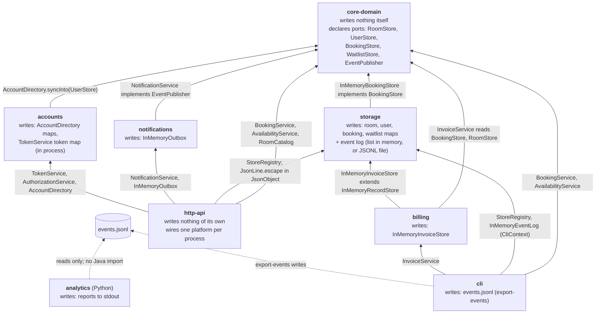
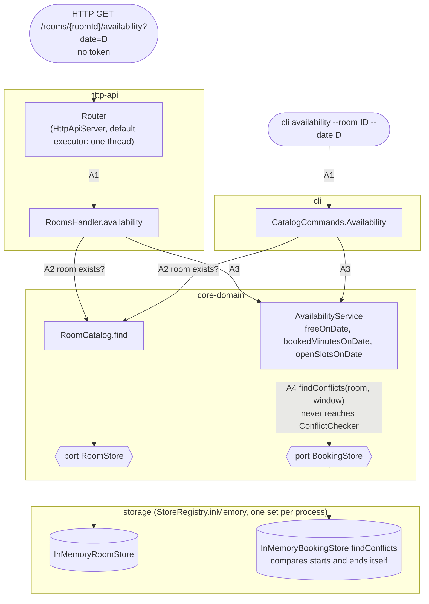
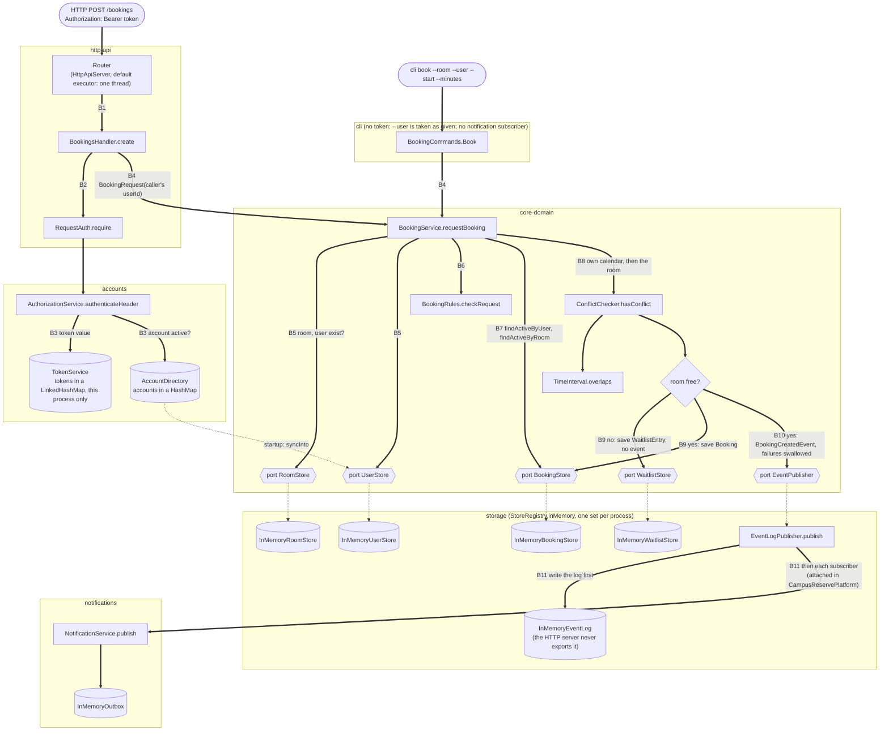

# BOUNDARIES.md

One section per milestone. Fill them in in order (the sketch before you write
anything about it, the copies next, the proposal last).

Draw Milestone 1's sketch from the code. A TA may ask where each arrow came
from.

Keep it short and specific. Point at modules, files, and callers.

---

## Milestone 1: The architecture as built

**The sketch.** Draw the modules, what each one writes, and the path an
availability request and a booking request each take from the entry point to
storage. Any form works (a Mermaid diagram in this file, or a photo of paper
kept beside it or linked here).

One page. The sketch is done when someone could use it to predict which module
a given change goes in.

Drawn from the code. Every arrow names the class that makes it true. The same
three pictures are in plain text, in `ARCHITECTURE.md`'s arrow style, in
[`milestone-1-sketch.md`](milestone-1-sketch.md).

*Modules, what each writes, and who depends on whom.* An arrow runs from a
module to a module it imports, labelled with the import that proves it.



*The availability request path (A1–A4).* No token, nothing written. `-->` is a
call, `-.->` is a port and the storage class behind it.



*The booking request path (B1–B11).* `==>` is a call, `-.->` is a port and the
storage class behind it (or startup wiring), cylinders are state that gets
written.



**Where your sketch and `ARCHITECTURE.md` disagree.** List at least two
places where your drawing and the repository's drawing are not the same
picture, each in one line. Include things you drew that it does not, and things it draws
that you did not.

1. **Availability skips `ConflictChecker`.** My availability path runs
   `AvailabilityService` → `BookingStore.findConflicts`. The docs say
   availability routes through the one overlap check (`AGENTS.md:46`, and
   `ARCHITECTURE.md:84` draws `ConflictChecker` as the only route to
   `TimeInterval.overlaps`).
2. **A second overlap check exists.** I drew `InMemoryBookingStore.findConflicts`
   comparing two starts and two ends itself. The docs call
   `TimeInterval.overlaps` "the only overlap implementation".
3. **Availability is not in their diagram.** I drew an availability path from
   both entry points to storage that never passes `BookingService`.
   `ARCHITECTURE.md`'s flow diagram (lines 74–96) only draws booking.
4. **CLI `book` has no token check.** I drew `BookingCommands.Book` going
   straight to `BookingService` with `--user` taken as given. `ARCHITECTURE.md`
   draws "(owner check via accounts)" across both entry points, and line 101
   says "the handler or command authenticates the caller".

**How you decided which one is right.** For each disagreement above, name the
check that settled it (the imports you read, the callers you listed, the wiring
you traced, the test that pins the behavior). "It looked that way" is not a
check, and neither is "the document says so". Your agent may produce the trace,
but check it before you rely on it.

1. **The code is right; the docs are wrong.** *Callers listed:*
   `grep -rl ConflictChecker */src/main` finds only `BookingService` and
   `ConflictChecker` itself. *Imports read:* `AvailabilityService` imports no
   `ConflictChecker`. Its only reads of booking data are
   `bookings.findConflicts(...)` at `AvailabilityService.java:35` and `:41`.
2. **The code is right; the docs are wrong.** *Callers listed:*
   `grep -rn '\.overlaps(' */src/main` finds calls only in `ConflictChecker`.
   *Code read:* `InMemoryBookingStore.java:61–62` restates the predicate from
   `TimeInterval.java:64` (`start < other.end && other.start < end`) instead
   of calling it. *Tests that pin it:* the storage copy is pinned on its own
   by `storage/.../FindConflictsTest.java` (for example
   `aBookingThatEndsWhenTheWindowOpensIsNotAConflict`).
   `AvailabilityServiceTest` runs against the test double
   `core-domain/src/test/.../support/InMemoryStores.java:109–112`, which does
   call `overlaps`. So core-domain's tests never exercise the copy production
   uses. The two agree today, but nothing ties them together.
3. **My sketch is right; their diagram leaves out a path.** *Wiring traced:*
   `CampusReservePlatform.java:50` and `CliContext.java:63` both build
   `new AvailabilityService(stores.bookings(), policy)`. That hands it the
   storage booking store directly, with no `BookingService`. `RoomsHandler`'s
   constructor takes only `RoomCatalog` and `AvailabilityService`.
4. **My sketch is right.** *Imports read:* `cli/pom.xml` has no `accounts`
   dependency, and `grep -rn accounts cli/src/main` finds nothing, so the CLI
   cannot authenticate anyone. *Code read:* `BookingCommands.java:44` takes
   `--user` from the flag and passes it to `requestBooking` at `:56`. Only the
   HTTP side calls `RequestAuth.require` (`BookingsHandler.create`).

---

## Milestone 2: Run it as copies

**Your stack.** The command that brought the stack up with two copies, and how
many distinct `X-Upstream` values your runs saw.

```
docker compose up -d --build --scale api=2
docker compose ps        # f26-lab09-api-1, f26-lab09-api-2, f26-lab09-proxy-1
docker compose logs api  # each copy prints its own u-1 and u-2 tokens
```

Two distinct `X-Upstream` values through the proxy (`172.19.0.3:8080` and
`172.19.0.2:8080`). `load/tokens.js` counts them itself in a
`distinct_upstreams` gauge, and its threshold fails the run below two.

`k6` has no `depends_on` in `compose.yaml` on purpose. With
`depends_on: [proxy]`, `docker compose run k6` reconciled `proxy -> api` and
removed `api-2` before the script started. That run reported 20/20 tokens
accepted with `distinct_upstreams` = 1, which is a pass that could not have seen
the problem.

### Finding 1: tokens

**The claim.** A token works on any request, whichever copy answers it.

**The script and its result.** The file in `load/`, its threshold, and what a
run printed.

`load/tokens.js` sends one copy's `u-1` token 20 times to `GET /bookings`
through the proxy (`http://proxy`).

```
docker compose run --rm -e TOKEN=<u-1 token from api-1> k6 run /load/tokens.js
```

Thresholds: `checks{claim:token-works-on-any-copy}: rate==1` (every request
gets a 200), and `distinct_upstreams: value>=2` (the guard: both copies
answered).

Run with two copies (k6 exit 99, claim **fails**):

```
status codes by copy (X-Upstream): {"172.19.0.3:8080":{"200":12},"172.19.0.2:8080":{"401":8}}
checks{claim:token-works-on-any-copy}  ✗ 'rate==1' rate=60.00%
distinct_upstreams                     ✓ 'value>=2' value=2
```

Run with one copy (the accidental scale-down above): claim 100%, guard ✗
`value=1`. So the claim check passes only when it cannot see the problem.

**Why, from the code.** The class that keeps tokens and how it is wired into
each copy. Say how you found it.

Tokens are kept only in a hashmap in TokenService. CampusReservePlatform creates a separate TokenService with its own random token generator(CampusReservePlatform.java:53) so each copy creates and accepts only its own tokens. A token from api-1 that goes to api-2 would miss.

**The kind of problem.** Use the vocabulary from lecture.
This is a state problem. The platform is trying to horizontally scale but without storing the state in a unified location misses between copies can occur. Copies aren't interchangeable behind a load balancer. 

### Finding 2: bookings

**The claim.** A room slot is booked at most once.

**The script and its result.** Say how it reaches each copy directly, and why
it has to.

`load/bookings.js` posts the same `roomId=r-1`, `start`, `minutes=60` twice:
once to `http://f26-lab09-api-1:8080` with api-1's `u-1` token, and once to
`http://f26-lab09-api-2:8080` with api-2's `u-2` token. Those are the container
names `docker compose ps` shows, resolved by Docker's DNS on the stack's
network. It skips the proxy because of Finding 1: through the proxy, a token
from one copy gets a 401 from the other about half the time, and the request
never reaches the conflict check. The slot is 2–13 days out, inside opening
hours and on a 15-minute boundary, because `r-1` is a `STUDY_ROOM`
(`RoomKind`: at most 14 days ahead).

```
docker compose run --rm -e TOKEN_A=<u-1 token from api-1> \
  -e TOKEN_B=<u-2 token from api-2> k6 run /load/bookings.js
```

Thresholds: `checks{claim:slot-booked-at-most-once}: rate==1` and
`double_bookings: count==0` (at most one 201 per slot), plus a guard,
`reached_two_copies: rate==1`. The guard passes only when both copies accepted
the request (201 or 202) and `res.remote_ip` differs between them.

Run against two copies (k6 exit 99, claim **fails**):

```
copy A (172.19.0.3) r-1 @ 2026-11-01T15:30:00Z: 201 {"outcome":"confirmed",... "userId":"u-1" ...}
copy B (172.19.0.2) r-1 @ 2026-11-01T15:30:00Z: 201 {"outcome":"confirmed",... "userId":"u-2" ...}
checks{claim:slot-booked-at-most-once}  ✗ 'rate==1' rate=0.00%
double_bookings                         ✗ 'count==0' count=1
reached_two_copies                      ✓ 'rate==1' rate=100.00%
```

Control, with both requests sent to api-1 (`-e COPY_B=http://f26-lab09-api-1:8080`
and api-1's `u-2` token). The claim passes and the guard fails:

```
copy A (172.19.0.3) r-1 @ 2026-11-11T17:30:00Z: 201 {"outcome":"confirmed",...}
copy B (172.19.0.3) r-1 @ 2026-11-11T17:30:00Z: 202 {"outcome":"waitlisted",... "position":1}
checks{claim:slot-booked-at-most-once}  ✓   double_bookings ✓   reached_two_copies ✗
```

Each run leaves one active booking per user on each copy. The default policy
caps a user at 5 active bookings, so bring the stack up fresh after a few runs.

**Why, from the code.**

BookingService.requestBookings reads this copy's bookings, checks for a conflict, and saves. Each copy's bookings live in their own memory, so api-2 checking for conflicts can't see that api-1 already booked a slot. 

**The kind of problem.**

The state-based invariant is checking local-only state, so this is again a state issue caused by not have a single soruce of truth.

### What you checked

One thing your agent proposed that you checked (what it proposed, how you
checked it, and what came of it).

I checked the finding 2 under milestone by running the script against 2 api copies with generated tokens to confirm the output matches agent's claim. 

---

## Milestone 3: One boundary

Take one problem from Milestone 1 or 2 and propose the boundary that fixes it.

**The boundary.** The port, what it promises, and which side implements it. Say what
moves and what stays.

**Who owns the data.** Name the module that owns the data this boundary is about,
and say what everybody else is allowed to do with it.

**The one invariant that must not cross.** Exactly one, stated so that a reader
can tell whether a given piece of code violates it.

**What the boundary costs.** An interface to keep, a second implementation to
maintain, a performance argument to have again. Include what it leaves unfixed.

Feel free to read the appendix on what a good proposal looks like in the Lab 3 handout
before you write this section.
