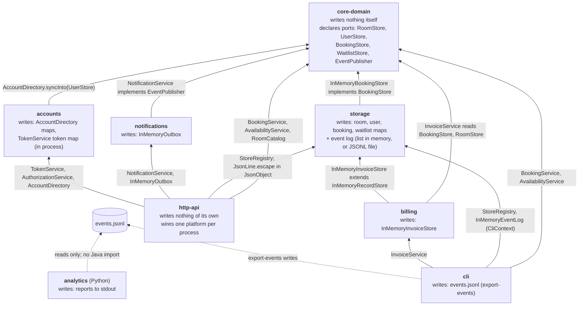
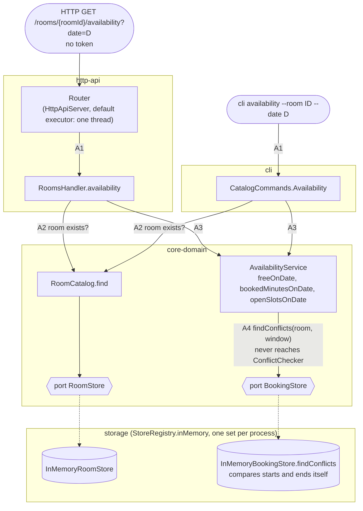
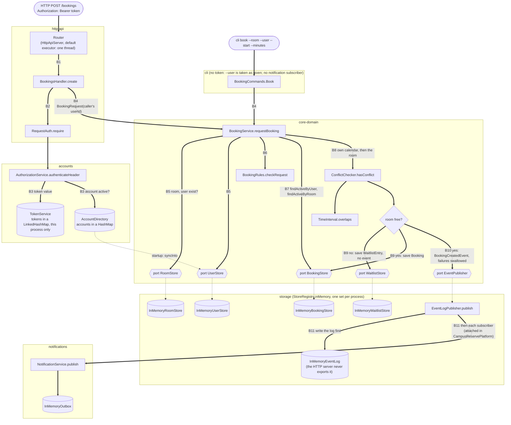

# Milestone 1: CampusReserve as built

Drawn from the code, not from `ARCHITECTURE.md`. Every arrow names the class
that makes it true. Each picture comes twice, once in Mermaid and once in plain
text in the style of `ARCHITECTURE.md`.

## 1. Modules, what each writes, and who depends on whom

An arrow runs from a module to a module it imports. The label is the import
that proves the edge.



Each block names a module and then every module that depends on it, with the
class that proves the edge.

```
core-domain    writes nothing itself, only through its ports
 ^  ^  ^  ^  ^  ^
 |  |  |  |  |  +--- cli            (BookingService, AvailabilityService)
 |  |  |  |  +------ http-api       (BookingService, AvailabilityService, RoomCatalog)
 |  |  |  +--------- billing        (InvoiceService reads BookingStore, RoomStore)
 |  |  +------------ accounts       (AccountDirectory.syncInto(UserStore))
 |  +--------------- notifications  (NotificationService implements EventPublisher)
 +------------------ storage        (InMemoryBookingStore implements BookingStore)

storage        writes: room, user, booking, waitlist maps; the event log
 ^  ^  ^
 |  |  +--- cli        (StoreRegistry, InMemoryEventLog in CliContext)
 |  +------ http-api   (StoreRegistry; JsonLine.escape in JsonObject)
 +--------- billing    (InMemoryInvoiceStore extends InMemoryRecordStore)

notifications  writes: InMemoryOutbox
 ^
 +--- http-api   (NotificationService, InMemoryOutbox)

accounts       writes: AccountDirectory maps, TokenService token map
 ^
 +--- http-api   (TokenService, AuthorizationService, AccountDirectory)

billing        writes: InMemoryInvoiceStore
 ^
 +--- cli        (InvoiceService)

http-api       writes nothing of its own; wires one platform per process
cli            writes: events.jsonl (export-events)

cli --export-events--> events.jsonl <--reads only-- analytics (Python, no Java import)
```

## 2. The availability request path

No token, and nothing is written.

- `-->` a call, numbered in order (A1–A4).
- `-.->` a port in `core-domain` and the `storage` class behind it at runtime.



```
HTTP GET /rooms/{roomId}/availability          CLI availability --room ID --date D
     |   (no token)                                       |
     v                                                    v
Router (http-api)                              CatalogCommands.Availability (cli)
     |                                                    |
     v                                                    |
RoomsHandler.availability (http-api)                      |
     |                                                    |
     +---------------------------+------------------------+
                                 |
                                 +----------> RoomCatalog.find (core-domain)
                                 |                 |
                                 |                 v
                                 |            RoomStore -> InMemoryRoomStore
                                 |            (port)       (storage)
                                 v
                    AvailabilityService (core-domain)
                    freeOnDate, bookedMinutesOnDate, openSlotsOnDate
                                 |
                                 v
                    BookingStore.findConflicts (port, core-domain)
                                 |
                                 v
                    InMemoryBookingStore.findConflicts (storage)
                    (compares two starts and two ends itself; never
                     reaches ConflictChecker or TimeInterval.overlaps)
```

## 3. The booking request path

- `==>` a call, numbered in order (B1–B11).
- `-.->` a port in `core-domain` and the `storage` class behind it at runtime,
  or wiring done at startup.
- Cylinders are state that something writes.



```
HTTP POST /bookings                            CLI book --room --user --start --minutes
     |   (Authorization: Bearer token)                    |   (no token; --user taken as given)
     v                                                    v
Router (http-api)                              BookingCommands.Book (cli)
     |                                                    |
     v                                                    |
BookingsHandler.create (http-api)                         |
     |                                                    |
     +----------> RequestAuth.require (http-api)          |
     |                 |                                  |
     |                 v                                  |
     |            AuthorizationService (accounts)         |
     |                 |                                  |
     |                 +---> TokenService      (token map, this process only)
     |                 +---> AccountDirectory  (is the account active?)
     |                                                    |
     +---------------+------------------------------------+
                     v
         BookingService.requestBooking (core-domain)
                     |
                     +----------> RoomStore.findById, UserStore.exists  (ports)
                     |              -> InMemoryRoomStore, InMemoryUserStore  (storage)
                     |
                     +----------> BookingRules.checkRequest   (duration, alignment,
                     |                                         opening hours, one UTC day)
                     |
                     +----------> BookingStore.findActiveByUser, findActiveByRoom
                     |              -> InMemoryBookingStore  (storage)
                     |
                     +----------> ConflictChecker ---> TimeInterval.overlaps
                     |            (own calendar first, then the room)
                     |
                     +-- room taken --> WaitlistStore.save -> InMemoryWaitlistStore
                     |                  (storage, writes; no event is published)
                     |
                     +-- room free
                            |
                            v
                     BookingStore.save -> InMemoryBookingStore  (storage, writes)
                            |
                            v
                     EventPublisher.publish(BookingCreatedEvent)
                     (core-domain port; BookingService swallows failures)
                            |
                            v
                     EventLogPublisher (storage)
                        |                       |
                        v  first                v  then
                  InMemoryEventLog         NotificationService (notifications)
                  (writes; the HTTP        (HTTP only: the CLI attaches none)
                   server never                 |
                   exports it)                  v
                                           InMemoryOutbox  (writes)
```
1. Availability skips ConflictChecker. RoomsHandler calls AvailabilityService, which calls BookingStore.findConflicts. AGENTS.md rule 3 says availability goes through the one overlap check.
2. A second overlap check exists. InMemoryBookingStore.findConflicts compares the two starts and two ends inline. 
3. Availability isn't in the booking diagram. CampusReservePlatform gives AvailabilityService the booking store directly, without going through BookingService.
4. CLI book has no token check. 
